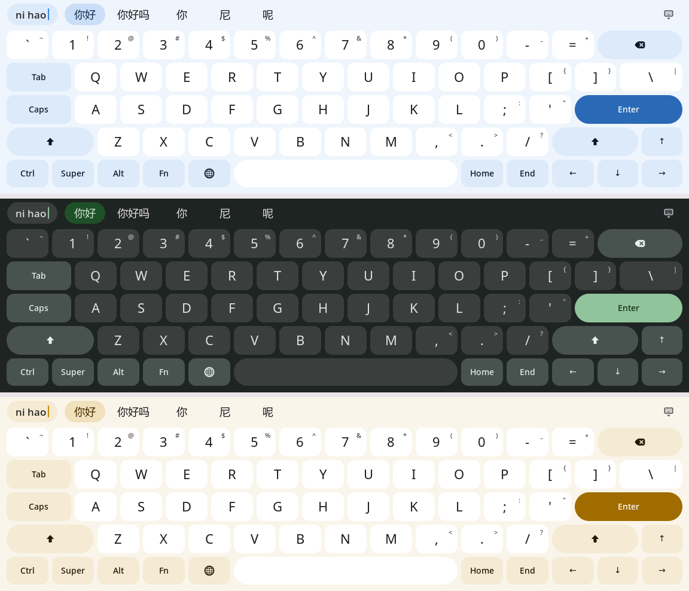

# Liuqin Fedora

**适用于小米平板 6 Pro（liuqin / SM8475）的 Fedora Linux 移植项目。**

当前版本基于 Fedora 45、GNOME 51 和 Linux 7.3.1（`7.3.1-liuqin-upstream1`）。仓库提供设备适配补丁、系统构建配置和安装工具，使 Fedora 能够在这款平板上启动并使用其硬件。

**[v0.1.0-alpha.2 已发布](https://github.com/psych2090707/liuqin-fedora/releases/tag/v0.1.0-alpha.2)** · 2026-11-12。新版汇总首版以来的键盘与输入、电源、声音、内核和启动修复。[查看更新说明](https://github.com/psych2090707/liuqin-fedora/releases/tag/v0.1.0-alpha.2)。

## 键盘新视觉



浅蓝、深绿、浅金：键盘跟随 GNOME 的明暗模式与强调色变化。五行电脑键布局，圆角字母键与胶囊动作键混排，拼音与候选词放在同一条输入栏；保留 Ctrl、Super、Alt、Fn 和方向键。

吸附键盘套时不自动弹出，需要时仍可从底部上滑唤出。扩展已预装，[点击查看启用方法](OPTIONAL.md#定制屏幕键盘实验性)。

## 安装

### 交给 AI 辅助安装

将下面的指令复制给**能够访问本机终端的 AI 编程助手**：

```text
请协助我在小米平板 6 Pro（liuqin）上安装此仓库的 Fedora：
https://github.com/psych2090707/liuqin-fedora

先阅读仓库的 README.md、INSTALL.md 和 AGENTS.md，按文档使用 Releases 中对应版本的安装工具。根据我的电脑系统和设备状态，完成环境检查、文件校验、固件准备、备份和安装演练（dry-run），然后告诉我检查结果和下一步操作。任何实际刷写、清除数据或修改分区的操作，都必须先取得我的明确确认；遇到型号、分区布局或校验不符时停止，不要自行猜测或绕过检查。
```

### 手动安装

1. **确认设备**：仅适用于小米平板 6 Pro（`liuqin`），需要事先解锁 Bootloader。
2. **获取文件**：从 [Releases](https://github.com/psych2090707/liuqin-fedora/releases) 下载同一版本的安装文件，按发布说明核对校验值。GitHub 自动生成的 *Source code* 压缩包不是系统镜像。
3. **运行安装工具**：在 Windows 11 或 Linux 电脑上解压安装包，进入其目录，先检查安装环境：
   - Windows：`powershell -ExecutionPolicy Bypass -File install-liuqin.ps1 doctor`
   - Linux：`python3 liuqin-install.py doctor`
4. **按步骤安装**：继续阅读 [INSTALL.md](INSTALL.md)，完成下载、在本地补齐设备固件、设置账户密码、安装演练和正式写入。不要跳过演练与备份。
5. **首次登录**：使用账户 `user` 和准备安装包时设置的密码登录 Fedora。

**目前仅支持 Linux 单系统安装。** 安装将替换 Android、清除现有用户数据并修改分区表；请先将重要文件备份到其他设备。双系统尚不支持。

## 硬件支持

显示、触屏、Wi-Fi、键盘套、音频等功能已有实机使用记录。触控笔、电源管理和充电功能也在持续适配；自动旋转、摄像头及部分睡眠唤醒问题仍未解决。

扬声器四声道调音已纳入本地准备流程，所需文件见 [原厂调音说明](STOCK-AUDIO.md)。

具体支持范围、已知问题与测试状态见 [HARDWARE.md](HARDWARE.md)。可选的屏幕键盘和外观定制见 [OPTIONAL.md](OPTIONAL.md)。

## 构建与维护

如果需要自行构建镜像或修改设备补丁，请从 [BUILD.md](BUILD.md) 开始。对应的内核源码、补丁和第三方组件见 [SOURCES.md](SOURCES.md)。系统日常更新与软件管理可参考 [GENERAL-RECOMMENDATIONS.md](GENERAL-RECOMMENDATIONS.md)。

遇到问题可在 [Issues](https://github.com/psych2090707/liuqin-fedora/issues) 反馈，提交前请阅读 [SUPPORT.md](SUPPORT.md)。

## 来源与说明

设备适配主要参考 [xiaomipad-6pro-mainline](https://github.com/yzddmr6/xiaomipad-6pro-mainline)、[linux-sm8450-liuqin](https://github.com/yzddmr6/linux-sm8450-liuqin) 和 [liuqin-nixos](https://github.com/Seeker0472/liuqin-nixos)；Fedora 构建参考 [pipa-fedora-builder-43](https://github.com/rr1111/pipa-fedora-builder-43)。各组件保留其原有许可证，详见 [NOTICE](NOTICE) 和 `LICENSES/`。

这是个人维护的社区项目。安装方式与硬件支持情况随版本记录在 [INSTALL.md](INSTALL.md) 和 [HARDWARE.md](HARDWARE.md)。
